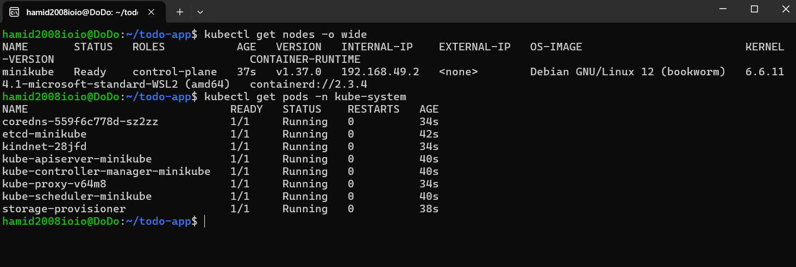
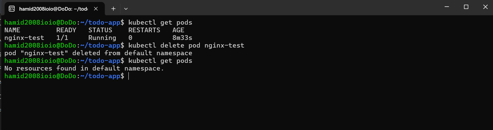
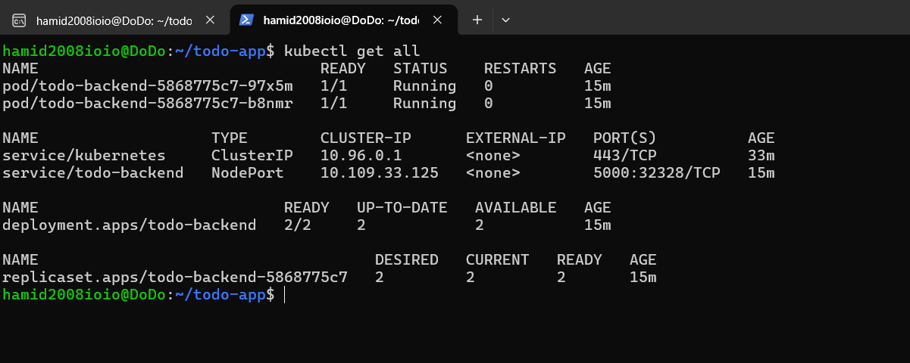
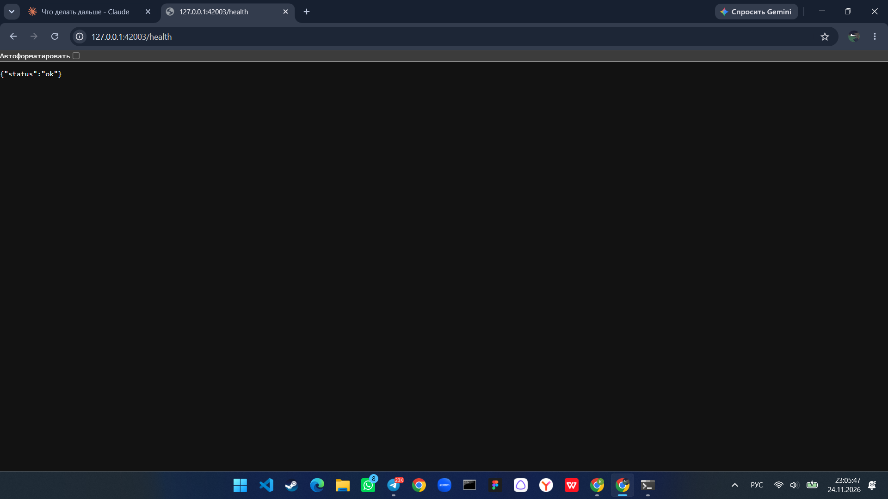
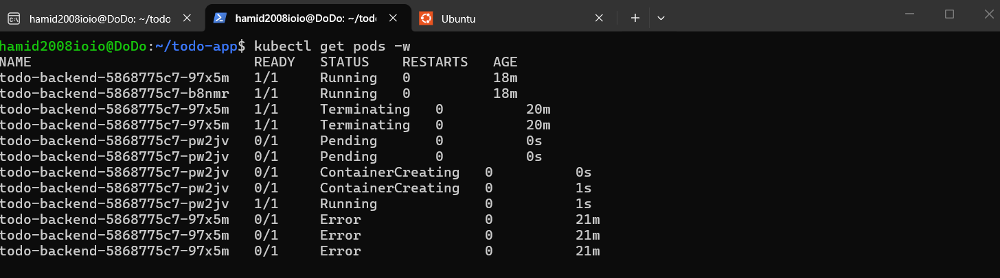

# Лабораторная работа 7 (часть 1). ToDo backend в minikube

Студент: hamid2008ioio

## Задание 1. Запуск minikube

**Сколько узлов в кластере?** Один узел `minikube` с ролью control-plane.

**Компоненты control plane:** `etcd-minikube`, `kube-apiserver-minikube`, `kube-controller-manager-minikube`, `kube-scheduler-minikube`.

## Задание 2. Pod без Deployment

**Появился ли Pod снова после удаления? Почему?** Нет. Pod был создан напрямую, без Deployment, и за ним никто не следит, поэтому его некому пересоздать.

## Задание 3. Backend: Deployment + Service

Манифест: [k8s/backend.yaml](../k8s/backend.yaml)

## Задание 4. Самовосстановление

**Совпадает ли имя нового Pod со старым?** Нет, старый `97x5m`, новый `pw2jv`: новый Pod получает другое случайное имя.

**Кто создал новый Pod и почему? Чем отличается от задания 2?** Новый Pod создал ReplicaSet под управлением Deployment: в манифесте `replicas: 2`, после удаления Pod-а осталось 1, и ReplicaSet создал недостающий. В задании 2 Pod был без Deployment, поэтому не восстановился.
